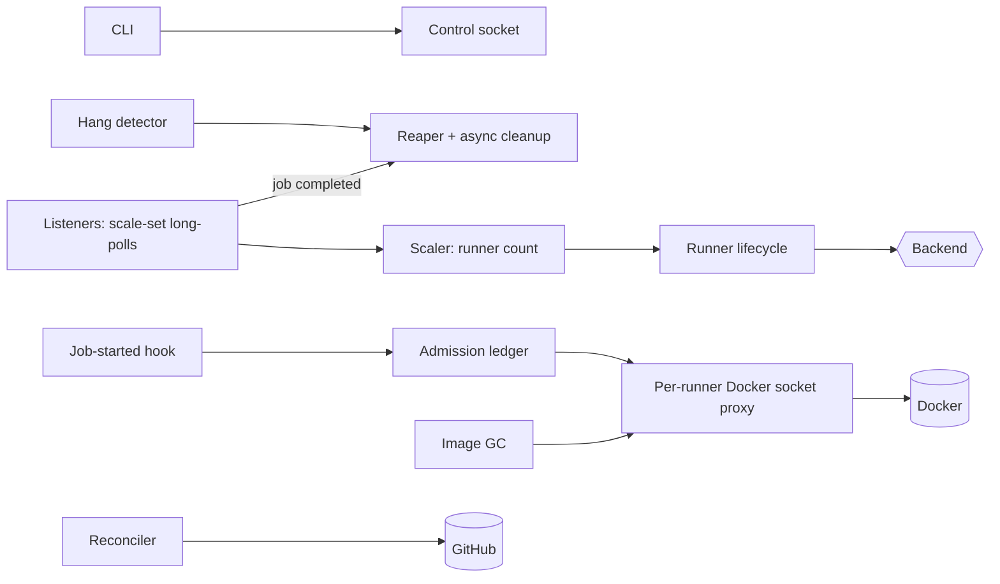

# runner-warden — plan

Greenfield. One daemon per host that serves ephemeral self-hosted GitHub Actions runners for the orgs and repos you add.
`<prefix>` is chosen at setup (docs example: `my-ci`). **[V]** = checked against GitHub/gh docs; **[U]** = unverified, resolve in the M0 spike.

## 1. Product

- Workflows use one label per OS: `<prefix>-linux` (alias `<prefix>`), `<prefix>-windows`, `<prefix>-macos`.
- Every job gets a fresh one-job runner. Idle runners are cheap; **memory is admitted at job start**, so small jobs never queue behind big ones.
- Scaling is **work-conserving**: one busy repo takes all spare capacity when nothing else is running; fairness only applies under contention.
- Setup is one command: `runner-warden setup`.

## 2. Decisions

| Topic | Choice | Why |
|---|---|---|
| Language | Go | Static binary; official scale-set client is Go |
| Demand signal | Runner Scale Set long-poll via `actions/scaleset` [V: MIT, public preview] | No inbound port, exact demand, job start/finish events, little REST budget [U] |
| Registration | Org-level where you are org admin; per repo for personal repos | Org needs `admin:org`, repo needs `repo` [V]; no user-level runners exist [V] |
| Runners | Ephemeral JIT, one job each [V] | Clean state, no stale registrations |
| Sizing | Job-start admission ledger — not size labels, not per-repo profiles | One repo can mix 0.5 GiB and 15 GiB jobs; labels would recreate pools |
| Docker in jobs | Sibling containers on the host Docker daemon via a **per-runner socket proxy** | `container:` / `services:` are the norm; shared image store; proxy enforces ownership, cgroup placement, cleanup |
| Host ceiling | One systemd slice for all job containers: `MemoryMax`, `MemorySwapMax`, **never `MemoryHigh`** | Hard cap fails one job; throttling can stall the whole slice |
| Backends | `docker` (Linux), `libvirt` (Windows guest), `tart` / `process` (macOS), one interface | Platform-neutral core |
| Label ownership | Each label owned by one manager | No cross-host coordination (shared labels deferred) |
| Packaging | Native binary + `runner-warden@<instance>.service` (default); GHCR image + compose as alternative | Native needed for slice + host scan |
| Build vs reuse | Build on `actions/scaleset`; check `runscaler` in M0 | ARC needs k8s, Philips is AWS-only; none covers admission, sibling ownership, VMs |

Rejected for Docker-in-job: DinD (privileged, re-pulls private images every job), sysbox (extra host dependency). The sibling model is root-equivalent on the host → trusted repos only; stated in the README.

## 3. Architecture



| Component | Job |
|---|---|
| Scaler | Keeps `demand` runners up; bounded by a runner-count cap derived from CPU |
| Admission ledger | Grants memory (and optional CPU slot) per job at start; VMs claim RAM at boot |
| Socket proxy | On every container/volume/network a job creates: ownership labels, slice cgroup parent, `oom-score-adj`, cache mounts + env; rewrites the runner's `docker.sock` bind to itself; tracks pulls in flight [V M0]. Runner dir sits at the same path on host and in the container. dockerd default `cgroup-parent` = instance slice so BuildKit is capped too |
| Reaper | On job-completed + 3 min grace: kill runner + everything labelled for that job. Cleanup on its own queue, never delays the next job. API error ⇒ do nothing |
| Image GC | The only prune path |
| Reconciler | Removes our orphaned registrations and resources (every 5 min + startup) |
| Naming | Sole source of every `<prefix>`-derived name |

## 4. Scaling, admission, limits

| Item | Design |
|---|---|
| Principle | One memory + CPU pool per host. Nothing pre-divided into slots; concurrency of containers, VMs, pinned jobs and cache copies is whatever fits now. Only user- or licence-imposed numbers are fixed |
| Capacity | Memory budget = slice `MemoryMax`; CPU = online cores − `reserved_cores` |
| Work-conserving | Any waiting job that fits is admitted. One busy target can take the whole host while others idle |
| Fairness (contention only) | Next grant goes to the target with lowest `granted memory / weight` (`weight` default 1). Per-target `max` default unlimited, `min` 0 |
| Large-job starvation | Once the oldest waiting job passes `reserve_after` (5 min), only jobs that don't delay it are admitted (backfill) |
| Runner count | Demand-driven. Idle/parked runners claim their measured overhead from the ledger, so memory is the only limiter. `max_runners` optional, default unlimited |
| Hook | `ACTIONS_RUNNER_HOOK_JOB_STARTED` (runs before job containers [V M0]) asks the daemon with repo/workflow/job/run; blocks until granted. Jobs can't be refused at accept time — scale sets assign server-side [V M0] |
| Prediction | `JobAssigned` messages carry job identity before any runner starts [V M0] → pre-warm runners and forecast memory by cost |
| Cost | First match: config rule (`repo/workflow/job` glob) → learned p90 of peak **anonymous** memory for that job → default. Container `--memory` caps are never used as cost |
| Queue | FIFO; jobs ≤ `light_threshold` may skip ahead. Timeout (default 40 min) fails the job clearly |
| Dynamic | Optional in-job `runner-warden acquire\|resize <GiB>` |
| Caveat | Waiting happens inside the job, so `timeout-minutes` keeps ticking [V M0]. `report` flags tight timeouts |
| CPU pinning | Rule may ask `pinned_cores = N`: ledger carves N whole physical cores (SMT siblings together) from unpinned cores for the job's duration. No predefined slots |
| OOM | Kills read from cgroup events, attributed to the job, shown in `status`/`check`, logged. Optional earlyoom config generated by setup |
| tmpfs | Per-job tmpfs size cap |

### 4a. Lanes (decided after the job-selection spike)

GitHub assigns FIFO, can't be told *which* job, but honours `maxCapacity` and lets several scale sets share a label [V]. So each (target, OS) gets **L lane scale sets** (`<prefix>-<os>-l1..lN`, default 4) all carrying the label `<prefix>-<os>`.

| Rule | Effect |
|---|---|
| Lane capacity = `started jobs + 1` | Each lane holds at most one unstarted job → the next runner in that lane gets it, deterministically |
| Job fits → start runner, reserve its cost | Work-conserving |
| Job doesn't fit → hold it (no runner) | It waits in GitHub's queue: **timeout not ticking** [V]. Other lanes keep flowing |
| Oldest held job older than `reserve_after` (5 min) | Only light jobs may overtake (anti-starvation) |
| All lanes of a target held > `hol_grace` (2 min) | Promote one job into the hook-wait (timeout ticks) to free a lane |
| Reassign churn (`canceled`, empty runner) | Treated as unbind; job keeps its age |
| Runner dies mid-job | Force-cancel immediately (don't wait GitHub's 14 min); single re-run if the loss wasn't an OOM |
| Drain | Capacity = started; held jobs stay queued |
| Multi-host (later) | A full host drops the `+1`; GitHub routes to the other host's lanes [V] |

## 5. Hang detection

| Signal | Default | Action |
|---|---|---|
| No CPU / IO / log growth | 30 min | Kill |
| Wall clock | 6 h | Kill |
| Job completed/cancelled but processes alive | 3 min | Reap |
| Runner never got a job | 10 min | Recycle |
| PR job whose PR is merged/closed, or whose head branch is deleted | Checked on job assign + every 2 min while queued/running | Cancel the run (queued jobs never start). Push jobs on a deleted branch likewise. `eventName` + `workflowRunId` from the scale-set message identify them [V] |
| Much slower than its own history | — | Report only |

Kill = cancel run via API → force-cancel → stop then kill labelled containers / VM → async cleanup (workspace, volumes, networks) → delete registration → record evidence.

## 6. Cache and images

| Topic | Design |
|---|---|
| Cache dirs | Config entries: host path, container path, env var, mode. Presets: Go, npm, pnpm, pip, cargo, Composer, pub, Gradle; custom allowed. Owner uid/gid + mode configurable |
| Modes | `shared` (tool safe under concurrent writers) or `pooled` (everything else) |
| Pooled | Pool of copies per cache + owner. Job checks out the warmest free copy; none free → new copy seeded by reflink/copy of the warmest idle one. Returned at job end. Pool follows peak concurrency; idle copies deleted after `pool_idle_ttl` (7 d) or LRU under disk pressure; in-use copies never evicted. VM guests use the same logic with cache disks |
| Injection | Proxy mounts them into the job's own `container:` as well as the runner |
| Never shared | Workspace, temp, home, credentials, lockfiles |
| Volumes | Every job volume labelled and removed at job end, incl. anonymous ones |
| Image GC | Only proxy-pulled images; only when no pull in flight (new pulls held briefly); at 85% disk or every 20 h for images unused > 24 h |
| Private registries | `credentials:` in the workflow with `GITHUB_TOKEN` + `packages: read` [U]. `doctor` flags private images without credentials |
| `actions/cache` | Untouched; report flags redundancy |
| "Optimise jobs" | Cache injection, warm caches, suggestions report. No workflow rewriting beyond the label sweep |

## 7. Prefix, ownership, instances

| Rule | Detail |
|---|---|
| Prefix | Required at setup, no default anywhere. `^[a-z][a-z0-9-]*[a-z0-9]$`, 2–32 chars, reserved words rejected. Runner name `<prefix>-<hostid:8>-<rand:8>` ≤ 50 (runner and scale-set limit 64 [V M0]). Labels never truncated — reject instead |
| Ownership | State-DB record + metadata `io.github.<owner>.runner-warden.{instance,host-id,job}`. **Nothing without our metadata is ever touched** — no foreign containers, images, volumes or runners |
| Prefix change | `runner-warden prefix set`: dry-run plan, drain, recreate, record old prefix |
| Instances | Several per host (own dirs, socket, slice, budget). Not a security boundary |

Paths: `/etc/runner-warden/<instance>/config.toml`, `/var/lib/runner-warden/<instance>`, `/var/cache/runner-warden/<instance>`, `/run/runner-warden/<instance>.sock`.

## 8. Security

| Topic | Position |
|---|---|
| Daemon token | `gh` token import or fine-grained PAT (Administration / Self-hosted runners write, Actions write [V]). **Never exposed to jobs** |
| Jobs needing GitHub access | `GITHUB_TOKEN`, a GitHub App token, or a secret. Host login is unsupported by design |
| Untrusted code | Public repos refused unless allowed; workflow fork fallbacks to hosted runners preserved |
| gh scopes | Default is `repo`, `read:org`, `gist` [V]. `admin:org` / `workflow` checked and added via `gh auth refresh -s` [V] |
| Secrets at rest | 0600 file / `systemd-creds` |

## 9. `runner-warden setup` (alias `install`)

| # | Step |
|---|---|
| 1 | Preflight: Docker, cgroup v2, memory, disk, existing instance (resume) |
| 2 | Prefix prompt + derived-name preview |
| 3 | Auth: import `gh` token, compute missing scopes, offer `gh auth refresh`, re-import |
| 4 | Select orgs, repos or all |
| 5 | Read-only scan: registered runners, local runner services/dirs/containers, every `runs-on` |
| 6 | One plan screen, single confirm (`--yes`, `--dry-run`) |
| 7 | Apply: slice + service → scale sets → smoke job (abort here if it fails) → label sweep (PR per repo; `--push`; `--print`) → retire old runners once idle (deregister, disable, archive) |

Idempotent, resumable from a journal; root steps via `sudo` with commands shown. In PR mode retirement completes after merge (re-run or daemon finishes it).

Label sweep:

| Form | Handling |
|---|---|
| Literal string / array | Rewritten in place, formatting kept |
| Expression with a literal label (e.g. fork fallback) | Only the literal replaced |
| Matrix values | Rewritten when literal |
| `vars.*` / `fromJSON(vars...)` | Reported; offers to update the variable |
| Anything else | Listed as "not rewritten" |

Other commands: `init`, `login`, `add`, `migrate plan|apply|rollback|finalize`, `status`, `logs`, `check`, `drain`, `kill`, `cache`, `report`, `doctor`, `prefix set`, `image build|import`.

## 10. VM backends

| Backend | Design |
|---|---|
| Sizing | Per profile `mem` + `vcpus`; claimed in full from the shared ledger at boot. Concurrency = as many as fit. Idle pre-booted VMs released first under contention |
| Windows-in-Docker (**v1 choice**) | `dockurr/windows` container (KVM) per Windows profile, owned by the daemon (labels, slice). Started on demand, stopped after `idle_ttl`; full VM RAM reserved while up. Per job: JIT runner launched in the guest over SSH (key from setup; port bound to localhost), fresh work dir, process tree killed + work dir wiped after. One job per VM; more VMs = more profiles, capped by `windows.max_concurrent`. `runner-warden windows provision` (clean install + bundled script + optional user script) or `windows adopt` (existing disk). Fresh disk per job deferred |
| `libvirt` (Windows, fallback) | Linked clone per job from a golden image; guest agent starts the runner with the JIT config. Extra cap: `windows.max_concurrent` = licence count (setup asks, never guesses). One licence per running instance [U]; not legal advice |
| `tart` / `process` (macOS) | Mac runs its own instance owning `<prefix>-macos`. VM per job via tart, built-in cap of 2 running macOS VMs per Mac (Apple licence [V]; tart inheriting it [U]), or bare process |

## 11. Milestones

| Milestone | Scope | Acceptance |
|---|---|---|
| M0 spike ✅ | Scale sets with `gh` token (org + repo); hook ordering + timeout; proxy with `container:` + `services:`; name limits | Done — see [spike/M0-FINDINGS.md](spike/M0-FINDINGS.md) |
| MVP | Linux backend, org + repo targets, proxy, slice, ledger with config costs, work-conserving scaler, reaper, async cleanup, OOM reporting, setup (non-destructive), status/logs/check | 100 light jobs finish while 3 heavy jobs hold the budget; one target with 50 queued jobs uses the whole budget while others idle, and grants converge to the weight ratio once a second target queues; an old large job is admitted within `reserve_after` + longest running job; summed job memory never exceeds the slice; cancelled run reaped within 5 min; foreign container/volume/`<prefix>-x` runner untouched; no leaked volumes after 50 service jobs; second `setup` is a no-op |
| v1 | Learned costs, cache manager, image GC, hang detector, CPU slots, label sweep + retirement + rollback, report, Windows backend, prefix change | Pull during GC never fails; warm-cache rerun faster; sweep keeps expressions and lists skips; legacy stack retired with zero failed jobs; Windows job runs in a fresh clone; concurrent Windows VMs = min(what fits, `windows.max_concurrent`); pinned jobs never share a physical core; a third pooled-cache job gets a seeded copy and the pool shrinks after the TTL |
| v1.1 | macOS `tart` + `process`, launchd | Job on `<prefix>-macos` runs and cleans up; a third macOS job waits while two VMs run |
| Later | Shared labels across hosts, GitHub App, device flow, proxy policy filtering, registry-auth injection, rootless profile | — |

## 12. Open source

Apache-2.0. goreleaser (linux amd64/arm64, darwin arm64; checksums, cosign, SBOM, deb/rpm), GHCR image, checksum-verifying `install.sh`. README with threat model up front, CONTRIBUTING (DCO), SECURITY.md (private advisories), CODE_OF_CONDUCT. Project CI on **GitHub-hosted runners only**: lint, race tests, naming property tests, literal-prefix guard, e2e against a fake GitHub server + real Docker, govulncheck, CodeQL, SHA-pinned actions.

## 13. Risks

| Risk | Mitigation |
|---|---|
| Socket proxy is the largest novel piece (hijacked streams, builds) | M0 spike; pass-through by default, mutate only create calls |
| Scale-set client is preview (v0.5.0) | Isolated behind one interface; pin version |
| Jobs see every host container through the proxy | Later: proxy policy filtering (list/inspect scoped to own labels) |
| Root-equivalent Docker access | Trusted repos only; documented |
| Learned costs wrong on first runs | Conservative default; slice hard cap as backstop |

## 14. Repo layout (planned)

```
cmd/runner-warden/        main, setup.go, prefix.go
internal/signal/          scaleset.go (listeners, job events)
internal/admission/       ledger.go, cpuset.go
internal/dockerproxy/     proxy.go
internal/backend/         backend.go, docker/, libvirt/, tart/, process/
internal/scaler/          capacity + fairness
internal/reap/, hang/, reconcile/, cache/, imagegc/
internal/naming/          naming.go (+ property tests)
internal/store/           sqlite, ownership.go
internal/migrate/         scan, plan, rewrite.go, rollback
packaging/                systemd/runner-warden@.service, compose/, launchd/, install.sh
images/windows/           Packer template
test/e2e/                 fake GitHub server + real Docker
```
